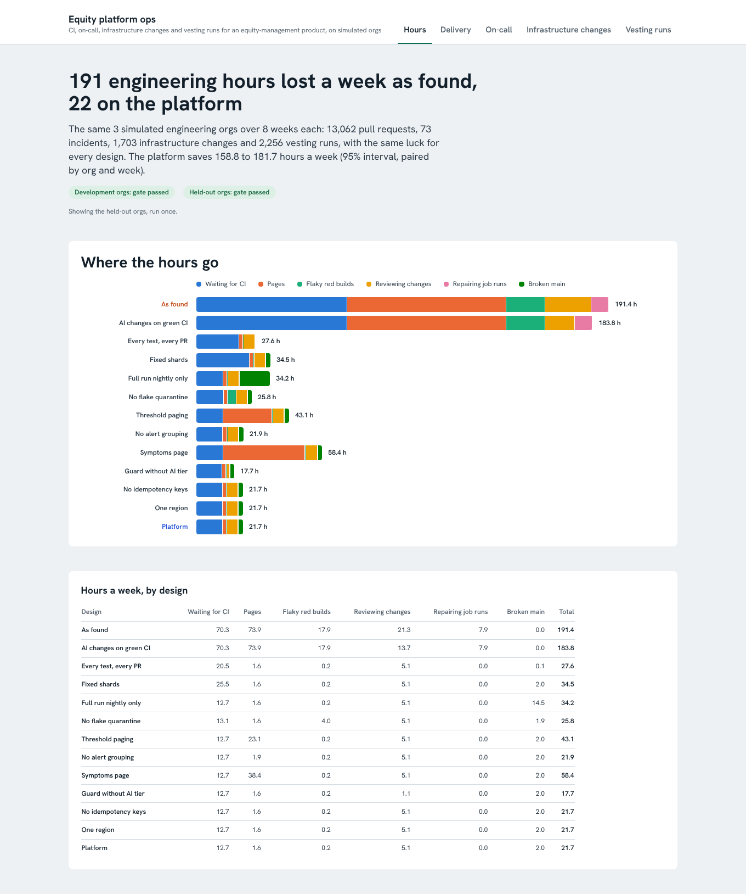
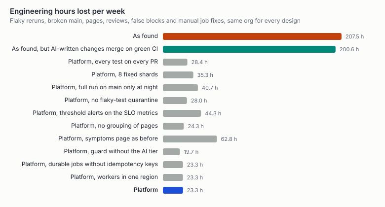
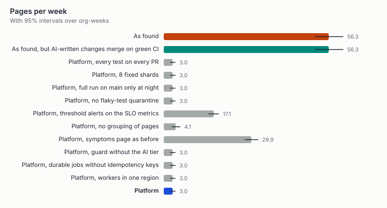

# equity-platform-ops

Platform for an equity-management product on GKE: a TypeScript API and Temporal workers on MongoDB, in two
regions, built with Terraform Cloud and GitHub Actions. It covers four things that cost a product team its
week, and measures each on a simulated engineering org, with the same luck for every design:

- **Delivery.** Pull requests run only the tests their change can reach, sharded by duration. A sequential test
  finds flaky tests and quarantines them. Main runs everything hourly.
- **On-call.** Pages come from error-budget burn on two windows, grouped by service. CPU, restarts and
  replication lag become tickets. Prometheus rules, Alertmanager routes and the Grafana dashboard are generated
  from one file and tested with promtool.
- **Infrastructure changes.** A guard reads each Terraform plan before it is applied. It blocks what is never
  right and sends what needs judgement to a person. It is stricter on changes written with an AI assistant.
- **Vesting runs.** Each monthly run is a Temporal workflow. Every write has an idempotency key, so a crashed
  worker's retry writes nothing twice. Workers run in Zurich and Frankfurt.

The headline is engineering hours lost per week: waiting for CI, flaky reds, broken main, pages, change review
and job repairs. Harmful changes applied and duplicate vesting records are reported beside it, not priced.



## Results

<!-- results:start -->

### Dashboard (development orgs)

| Development | Platform | AI changes on green CI | As found |
|---|---:|---:|---:|
| PR feedback, median / p90 (minutes) | **7.5 / 8.0** | 37.7 / 71.6 | 37.7 / 71.6 |
| Red builds from flaky tests per week | **1.0 (0.5–1.5)** | 79.2 (70.4–89.0) | 79.2 (70.4–89.0) |
| Hours main is broken per week | **4.8** | 0.0 | 0.0 |
| CI runners per month | **€1,152** | €3,337 | €3,337 |
| Pages per week (95% interval) | **3.0 (2.2–4.0)** | 56.3 (51.6–61.3) | 56.3 (51.6–61.3) |
| ... outside working hours | **1.1** | 37.7 | 37.7 |
| Page-worthy incidents paged for | **98% of 52** | 100% of 52 | 100% of 52 |
| Harmful infrastructure changes applied | **1 of 62** | 48 of 62 | 19 of 62 |
| Review hours per week | **4.5** | 13.3 | 20.2 |
| Median hours from plan to apply | **0.3** | 2.4 | 5.1 |
| Duplicate grant records from job retries | **0** | 8,350 | 8,350 |
| Equity jobs finished late | **0 of 2,256** | 124 of 2,256 | 124 of 2,256 |
| API minutes down per month in region outages | **3.6** | 96.6 | 96.6 |
| Standby region per month | **€910** | €0 | €0 |
| Engineering hours lost per week | **23.3** | 200.6 | 207.5 |

3 simulated orgs, 8 weeks each: 13,159 pull requests, 87 incidents (52 page-worthy), 1,616 infrastructure changes, 2,256 equity job runs.





### Every design on the same orgs

| Design | Feedback p90 | Flaky reds / wk | Main broken h / wk | Pages / wk | Harmful applied | Duplicates | Late jobs | Eng. hours / wk |
|---|---:|---:|---:|---:|---:|---:|---:|---:|
| As found | 71.6 | 79.2 | 0.0 | 56.3 | 19 | 8,350 | 124 | 207.5 |
| As found, but AI-written changes merge on green CI | 71.6 | 79.2 | 0.0 | 56.3 | 48 | 8,350 | 124 | 200.6 |
| Platform, every test on every PR | 11.2 | 0.9 | 0.1 | 3.0 | 1 | 0 | 0 | 28.4 |
| Platform, 8 fixed shards | 29.4 | 1.0 | 5.1 | 3.0 | 1 | 0 | 0 | 35.3 |
| Platform, full run on main only at night | 8.0 | 1.0 | 39.5 | 3.0 | 1 | 0 | 0 | 40.7 |
| Platform, no flaky-test quarantine | 8.0 | 18.0 | 4.8 | 3.0 | 1 | 0 | 0 | 28.0 |
| Platform, threshold alerts on the SLO metrics | 8.0 | 1.0 | 4.8 | 17.1 | 1 | 0 | 0 | 44.3 |
| Platform, no grouping of pages | 8.0 | 1.0 | 4.8 | 4.1 | 1 | 0 | 0 | 24.3 |
| Platform, symptoms page as before | 8.0 | 1.0 | 4.8 | 29.9 | 1 | 0 | 0 | 62.8 |
| Platform, guard without the AI tier | 8.0 | 1.0 | 4.8 | 3.0 | 2 | 0 | 0 | 19.7 |
| Platform, durable jobs without idempotency keys | 8.0 | 1.0 | 4.8 | 3.0 | 1 | 2,156 | 0 | 23.3 |
| Platform, workers in one region | 8.0 | 1.0 | 4.8 | 3.0 | 1 | 0 | 0 | 23.3 |
| **Platform** | 8.0 | 1.0 | 4.8 | 3.0 | 1 | 0 | 0 | 23.3 |

### Held-out orgs (run once)

| Held-out | Platform | AI changes on green CI | As found |
|---|---:|---:|---:|
| PR feedback, median / p90 (minutes) | **7.4 / 8.1** | 29.5 / 51.0 | 29.5 / 51.0 |
| Red builds from flaky tests per week | **0.9 (0.5–1.3)** | 71.8 (61.9–81.8) | 71.8 (61.9–81.8) |
| Hours main is broken per week | **3.9** | 0.0 | 0.0 |
| CI runners per month | **€1,222** | €3,348 | €3,348 |
| Pages per week (95% interval) | **1.6 (1.0–2.2)** | 51.5 (48.5–54.4) | 51.5 (48.5–54.4) |
| ... outside working hours | **0.5** | 35.3 | 35.3 |
| Page-worthy incidents paged for | **97% of 35** | 100% of 35 | 100% of 35 |
| Harmful infrastructure changes applied | **5 of 71** | 46 of 71 | 25 of 71 |
| Review hours per week | **5.1** | 13.7 | 21.3 |
| Median hours from plan to apply | **0.3** | 2.4 | 5.2 |
| Duplicate grant records from job retries | **0** | 7,550 | 7,550 |
| Equity jobs finished late | **0 of 2,256** | 121 of 2,256 | 121 of 2,256 |
| API minutes down per month in region outages | **0.9** | 30.2 | 30.2 |
| Standby region per month | **€910** | €0 | €0 |
| Engineering hours lost per week | **21.7** | 183.8 | 191.4 |

3 simulated orgs, 8 weeks each: 13,062 pull requests, 73 incidents (35 page-worthy), 1,703 infrastructure changes, 2,256 equity job runs.

Gate (`config/gate.yaml`) on the held-out orgs: **passed**.

The record of that run: [docs/heldout.md](docs/heldout.md).

<!-- results:end -->

## What is real and what is simulated

| Part | Real | Simulated |
|---|---|---|
| Vesting worker and API (`apps/equity-worker`) | TypeScript, Temporal SDK 1.13, MongoDB driver, tRPC, prom-client. Tests run a workflow on a Temporal dev server against MongoDB (FerretDB locally) and kill an activity after its write. | – |
| Alerting (`ops/`) | Prometheus recording and alert rules, tested with promtool; Alertmanager routes; Grafana dashboard JSON. | The incidents and traffic in the evaluation. |
| Plan guard (`epo/guard`) | Reads real `terraform show -json` output; CLI and pull-request workflow. | The 1,616 changes in the evaluation, and which are harmful. |
| CI selection and flake detection (`epo/ci`) | The algorithms. | The repository: 60 packages, 3,200 tests, flaky rates, defects. |
| Infrastructure (`infra/terraform`, `deploy/k8s`) | GKE in two regions, Artifact Registry, Atlas across three regions, budgets; kustomize overlays per region. Validated in CI. | Never applied: there is no GCP project behind it. |

## Limits

- Every number in the results is about simulated orgs. The world's rates (flaky share, defect rate, harmful
  rate of AI-written changes, crash rate) are assumptions in `config/world.yaml`; the ablations show which part
  of the platform carries each result.
- The Terraform is validated, not applied. Temporal Cloud, the global load balancer and the ingress are not in it
  yet.
- The guard's rules miss what they do not describe: on the held-out orgs 5 of 71 harmful changes still applied.
- Paging on budget burn pages later than thresholds: about 17 to 21 minutes after an incident starts, against 4.

## Run it

```bash
pip install -r requirements-dev.txt
python -m pytest                       # seconds
python -m epo.eval.cli evaluate        # development orgs: reports/, charts, this README's results
python -m epo.eval.cli gate --dev
python -m epo.guard infra/guard-examples/db_open.json --commit-messages infra/guard-examples/db_open.commits.txt

# dashboard
(cd web && pnpm install && pnpm build) && uvicorn epo.service.api:app --port 8080

# worker: MongoDB on 27017 and a Temporal CLI binary
cd apps/equity-worker && pnpm install && TEMPORAL_CLI=$(which temporal) pnpm test
```

## Layout

| Path | What |
|---|---|
| `epo/world` | The simulated org and its hidden truth |
| `epo/ci`, `epo/slo`, `epo/guard` | Test selection and flake detection; burn alerts and generated rules; the plan guard |
| `epo/sim`, `epo/eval` | Designs, engine, evaluation, gate, reports |
| `epo/service`, `web/` | The dashboard's API and the React dashboard (Vite, Tailwind tokens, Framer Motion) |
| `apps/equity-worker` | Vesting workflows and the tRPC API, in TypeScript |
| `infra/terraform`, `deploy/k8s` | GCP in two regions; Kubernetes base and region overlays |
| `ops/` | Generated Prometheus rules (with tests), Alertmanager routes, Grafana dashboard |
| `docs/adr`, `docs/runbooks` | Decisions and what to do when an alert fires |
| `config/` | Every setting; `heldout.lock` records the one held-out run |

More screenshots: [delivery](docs/screenshots/delivery.png), [on-call](docs/screenshots/oncall.png),
[infrastructure changes](docs/screenshots/changes.png), [vesting runs](docs/screenshots/jobs.png).
